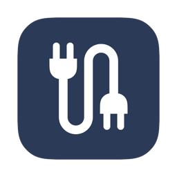
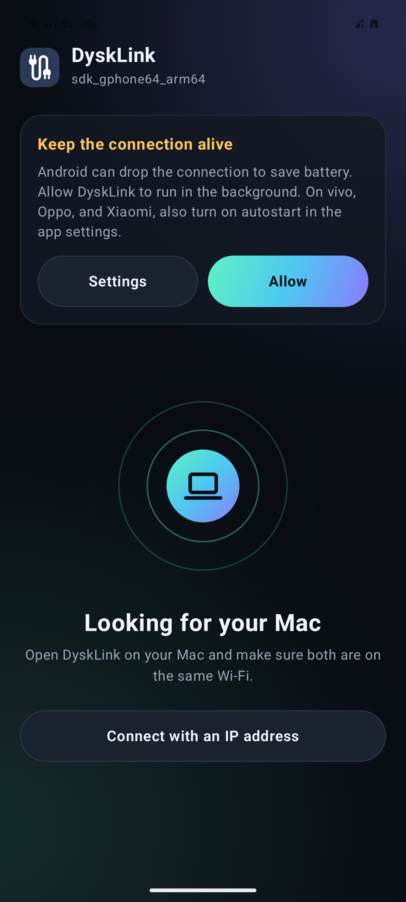
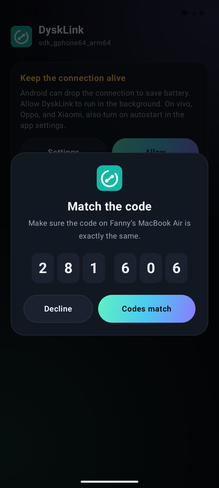

<p align="center">
  
</p>

<h1 align="center">DyskLink for Android</h1>

<p align="center">Connects your Android phone with your Mac or Windows/Linux PC over local Wi-Fi or USB, with no cloud and no account.</p>

<p align="center">
  <a href="https://github.com/DyskLab/dysklink-android/releases/latest"></a>
  <a href="LICENSE"></a>
  <a href="https://dysklab.fanny.dev"></a>
  <a href="https://buymeacoffee.com/fannydevz"></a>
</p>

| Looking for your Mac | Pairing |
| --- | --- |
|  |  |

**This is the phone app.** The computer apps are [DyskLink for Mac](https://github.com/DyskLab/dysklink-mac) and
[DyskLink for Windows and Linux](https://github.com/DyskLab/dysklink-desktop). You need one of them for the computer features. The Tools tab works on the phone alone, and two phones with
DyskLink can work together.

> DyskLink is still young, so expect rough edges.

## Download
You need Android 8 or later. Sound from this phone needs Android 10 or later. See
[COMPATIBILITY.md](https://github.com/DyskLab/dysklink-mac/blob/main/COMPATIBILITY.md) (in Indonesian) for what each
Mac supports.

1. Download `DyskLink-android-<version>.apk` from the
   [latest release](https://github.com/DyskLab/dysklink-android/releases/latest) and open it on your phone. Android asks
   you to allow installing from that source.
2. Install [DyskLink for Mac](https://github.com/DyskLab/dysklink-mac#download) 1.5.0 or
   [DyskLink for Windows and Linux](https://github.com/DyskLab/dysklink-desktop) 1.0.0 or later, and open it on the
   same network.
3. Type the 6-digit code the computer shows into the phone. After that, they connect by themselves.

To update, install the new APK over the current one. Pairings and settings are kept. Releases from 1.0 on are signed
with the DyskLink release key. Releases before 1.0 were debug builds, so moving from one of those means uninstalling
it first, which erases its pairings. Pairing a new device needs 1.2.0 or later on both sides.

**Updates:** once a day, DyskLink reads the public list of releases on GitHub. When a newer version is out, it sends
one notification and shows **Download** at the top of the Devices tab, which opens the new APK in your browser. It
sends nothing about your phone and never installs anything by itself. You can turn this off or check now under
**Tools > Updates**.

## With a computer
Everything here works with a Mac or a Windows/Linux PC unless it says Mac. Which computer features exist on Windows and
Linux is in the [DyskLink for Windows and Linux](https://github.com/DyskLab/dysklink-desktop#features) README.

- **Connection:** encrypted pairing, several computers, automatic reconnection, and connectivity reports (carrier,
  network type, signal strength).
- **USB:** turn on USB debugging and plug the phone into the computer. DyskLink moves the connection to the cable
  within a few seconds and shows Connected over USB. Unplug to go back to Wi-Fi.
- **Files:** send files both ways. Files from a computer go to Download/DyskLink, and tapping one in the transfer
  list opens it. On Android 9 and older they stay in the app's own folder. **File history** lists every file sent and
  received, by day, with filters, search, open, share, and remove from list.
- **Clipboard:** copies on the computer arrive on the phone, and the phone can send its copies back.
- **Remote control:** touchpad, keyboard, media remote, and presentation remote, and commands listed in advance on the
  computer. In Presentation, hold the **Hold to point** pad and turn the phone to move the pointer (air mouse); a
  quick tap clicks.
- **Stream Deck:** big buttons that run keyboard shortcuts, media keys, typed text, or commands on the computer.
  Edit names, colors, actions, and order, with 2 to 4 buttons per row. OBS buttons talk to OBS's built-in WebSocket
  server directly (OBS 28 and newer), so they work with OBS on any computer: scenes, streaming, recording, replay,
  virtual camera, mute, and showing or hiding sources, lit up to match OBS.
- **Terminal:** a real shell on the computer with colors and full-screen programs (vim, top, htop), an extra keys
  row, paste, and pinch to zoom. The computer has to allow it first, and the phone asks for your fingerprint or
  screen lock every time.
- **Computer screen:** on a computer's page, its screen live. Tap to click, tap twice to double-click, hold to
  right-click, drag to drag, two fingers to scroll, and pinch to zoom. Type opens the phone keyboard. Turn on "View
  this screen from the phone" on the computer first.
- **Second display:** makes this phone an extra display of the computer, turned sideways, with tap, drag, and type
  as in the computer screen.
- **Phone data for the computer:** notifications, reading and sending SMS, call alerts, contacts, read-only file
  access, and the Gallery of photos and videos. See [Phone data](#phone-data).
- **Phone screen:** share the phone's screen to the computer, with its sound and optional mouse and keyboard
  control. See [Screen and control](#screen-and-control).
- **Camera to computer:** streams the back or front camera to a window on the computer. A computer can also ask; the
  phone shows a notification and starts only after a tap. Switch lenses, turn on the light, or stop it from either
  side.
- **Sound sharing:** plays the computer's sound on this phone (turn on "Let phones hear this Mac" on the Mac first),
  or plays this phone's sound on the computer (Android 10 or later). Android asks before recording, and apps that
  block recording stay silent.
- **Photo sync:** PHOTOS > Send new photos sends photos and screenshots taken from then on to the computer whenever
  it's connected (Pictures > DyskLink on a Mac). Photos already on the phone aren't sent.
- **Scan barcodes and documents to the computer:** a scanned code is typed where the cursor is, followed by Enter,
  Tab, or nothing. A scanned document goes over as a PDF.
- **Voice typing:** speak in Indonesian or English and the words are typed on the computer, with spoken punctuation
  ("titik", "koma", "baris baru", "comma", "new line") and capitals at the start of sentences. Uses the phone's speech
  recognizer and needs microphone access.
- **Todo, water and Pomodoro:** the computer's todo list, water count, and Pomodoro can be changed from the phone.
  Optionally, the phone turns on priority-only Do Not Disturb during focus rounds. That needs Do Not Disturb access,
  and leaves a Do Not Disturb you set yourself alone.
- **Find each other:** ring the computer from the phone, or the phone from the computer. The phone rings on the alarm
  stream at full volume for up to 30 seconds, even on silent, then puts the volume back.
- **Wake Mac:** when a paired Mac is offline or shows "Not answering", its page has **Wake Mac**, which sends
  Wake-on-LAN over Wi-Fi. When the Mac wakes, the phone reconnects at once. If it doesn't come back within 45 seconds,
  the app explains why: a MacBook on Wi-Fi only wakes on the charger with an Apple TV or HomePod on the network, or
  over Ethernet, and "Wake for network access" has to be on. A Mac that is shut down can't be woken. DyskLink for Mac
  1.5.0 can also stay reachable while charging, so it doesn't sleep in the first place.
- **Quick Settings tiles and widgets:** Send clipboard, Lock Mac, and Keep Mac awake tiles. Widgets: the Mac's
  battery with buttons, Quick note, Todo (tap a task to tick it), Pomodoro and water (the timer counts down on the
  home screen), Mac media, Battery (this phone, computers, and other phones), and Buttons (pick up to four: Send
  clipboard, Lock Mac, Keep awake, Ring Mac, Play / pause, Touchpad, Terminal, Commands, Stream Deck). Keep Awake only
  works while it is turned on in the Mac's Advanced page.

## Between phones
Phones with DyskLink on the same Wi-Fi show up under Devices. Tap one, then type the code it shows. Each phone has one
page with Send file, Find, and Clipboard at the top, then a grid of tools:

- **Screen:** see and control the other phone's screen. Android asks each time, and the shared phone shows "Being
  viewed". Control needs a separate switch and Accessibility.
- **Camera:** live viewfinder, lens switch, torch, zoom, a 3 or 10 second timer, photos and short videos, saved on the
  camera phone and sent to you.
- **Notifications and Messages:** see the other phone's notifications, reply, mark as read, or dismiss them, and get
  call alerts. Read and send SMS with the other phone's SIM; that needs your fingerprint or PIN, is limited to 10 a
  minute, and the SIM phone logs and notifies every send.
- **Talk and Sound:** hold to talk to the other phone, or play this phone's sound on it (Android 10 or later).
- **Music, Send link, Quiet:** a music remote; links, map locations, or phone numbers that open only when tapped
  there; and Silent, Vibrate, or Do Not Disturb for a while, with Undo on the other phone.
- **Locate and Monitor:** where the other phone is, with Open in Maps; low and full battery alerts and today's screen
  time. Hold **Find** for Ring + flash.
- **Move phone and Photo backup:** move contacts, photos, videos, and folders to a new phone with pause and resume,
  and use a phone as a photo sync target. Every target can be limited to while charging.

Every feature is off until the receiving phone allows it for that phone. Its **Permissions** page shows everything
another phone may do on it, and what it sends there, as Allowed, Ask first, or Never. Turn the whole thing off with
Connect with other phones.

## Tools
The Tools tab works without a computer.

- **Scan barcodes:** actions that fit the code (open a link after confirming it, join Wi-Fi, add a contact, call,
  message, email, maps, search a product), and a history of the last 200 codes you can copy or share as CSV. With a
  computer picked, each code is also typed on it. Keep scanning reopens the camera after each code.
- **Scan document:** Google's document scanner (through Play Services) finds the paper's edges and lets you crop and
  clean up pages, and ML Kit reads the text. The PDF, with optional JPEG pages, is saved to Documents/DyskLink/Scans
  or sent to a computer or another phone.
- **Todo, Water, and Pomodoro:** a todo list, a daily water goal with reminders, a 7-day chart, and "Drank a glass"
  from the notification, and a Pomodoro that keeps running with the screen off, with a countdown notification that
  has Pause and Skip.
- **Prayer times and weather:** choose a city for today's prayer times from equran.id, with a reminder at each time or
  10 minutes before, and the weather and next 3 days from Open-Meteo. A month of times is kept on the phone so they
  work offline, and a home screen widget shows the next prayer. Only the chosen city goes to equran.id, and only its
  coordinates to Open-Meteo. On-time reminders need **Alarms & reminders** access, otherwise Android may send them a
  few minutes late.
- **Network tools:** this connection's details, a download and upload speed test against speed.cloudflare.com,
  devices on the same Wi-Fi found by checking a few common ports and guessing what they are, and ping. The speed test
  uses test data, so it warns on metered connections.
- **Stream Deck:** OBS buttons work from here without a computer paired with DyskLink.
- **Phone tools:** storage clean-up (large files, old downloads, leftover APKs, empty folders; nothing is removed
  until you pick and confirm), apps with size and last use (needs Usage access), and which apps hold sensitive
  permissions.
- **Phone files in a browser:** a small read-only web server, so any laptop on the same Wi-Fi can browse, open, and
  download the phone's files after entering a PIN shown on the phone. It stops after 30 minutes without use and
  needs All files access. The connection isn't encrypted, so use it on a trusted Wi-Fi.
- **Charge reminder:** once per charge, a notification when the battery reaches a limit you choose (80% by default),
  and a list of recent charges. Android doesn't let apps stop charging, so it only reminds. Off by default.
- **Appearance:** System, Dark, or Light. Dark is the default. Widgets follow light and dark mode, and use the
  wallpaper colors on Android 12 and later.

## Phone data
Notifications, SMS, calls, contacts, files, gallery, screen requests, and control from a computer are **off by
default**. Turn them on one by one under **choose a computer > Phone data for Mac**. The phone rechecks every request
from a computer against the switch and the Android permission, and your choice applies to every paired computer.

- File access is limited to internal storage and is read-only. Files whose names start with a dot are hidden unless
  **Show hidden** is ticked on the computer. Several files can be downloaded together, and the phone sends two at a
  time.
- Notifications their app marks as secret are not sent. Other notifications are sent as they are, so verification
  codes from banking apps or SMS can appear on the computer.
- SMS is sent with the phone's number and credit, through the default SMS SIM. RCS is not supported.

## Screen and control
- Screen sharing always needs approval in the Android dialog for each session, even when requested from the computer.
  While it runs, a phone notification offers a Stop button. The phone's sound goes with its screen unless "Sound with
  this phone's screen" is off.
- Control from the computer has its own switch and needs the Accessibility permission. It is refused while the phone
  is locked, so a PIN can't be entered from the computer, and text is never typed into password fields.
- Apps that protect their screen, such as banking apps, appear black on the computer.
- Mouse drags and scrolling are sent as one live touch on the phone. If the phone cancels that touch, the movement is
  replayed as one gesture when the button is released. A touch is lifted automatically after 10 seconds without news
  from the computer, so a lost connection can't leave it pressed.

## Permissions
- **Clipboard:** since Android 10, background apps can't read the clipboard. Text leaves the phone through the
  **Send clipboard** button in the DyskLink notification, when DyskLink is opened, or from the Share menu, or
  automatically if you turn on **Send phone copies automatically**. That option is off by default. It needs the
  Accessibility service, which then checks the labels of tapped buttons and toasts for words like Copy, without
  storing or sending them, and opens a brief transparent screen to read the clipboard. Copied passwords can be sent
  unless the app marks them private, and icon-only copy buttons may not be noticed. The computer confirms each text.
  Without a confirmation within 4 seconds, the phone reconnects and sends it again. Computer to phone is automatic.
- **Phone data:** requested when the feature is turned on. Notification access and all-files access are granted on
  Settings pages. If the option is grayed out, open DyskLink's App info, tap the three-dot menu, then allow restricted
  settings.

The SMS, call log, and all-files permissions make this app unsuitable for Google Play without a special application,
so it is installed directly.

## How connecting works
- The phone finds computers through mDNS, a /24 subnet scan, or a manual IP address. With USB debugging on and the
  cable plugged in, the computer moves the connection to USB.
- A new computer brings up pairing right away while the app is open: the computer shows a random 6-digit code and you
  type it on the phone. The code is checked with a password-authenticated key exchange (CPace) over TLS, so a device
  listening on the Wi-Fi can't work it out. After that, connecting is automatic.
- The app uses a foreground service and a 25-second heartbeat, and reconnects when the network changes. The service
  also starts again after the phone reboots.

To stay connected, allow DyskLink to run in the background from the card in the app. On vivo, Oppo, and Xiaomi, also
turn on autostart.

## Windows and Linux
DyskLink for Windows and Linux is in [DyskLab/dysklink-desktop](https://github.com/DyskLab/dysklink-desktop): one
Kotlin app (Compose for Desktop) on the same `core/` module as the phone app, which it takes from this repository as a
git submodule. Its source, releases, user guide, and build steps are there. `core/` stays here, so a change to it is
made here first and then picked up there by moving the submodule forward.

## Build and install
You need Android 8 or later on the phone, JDK 17, and the Android SDK. Set `ANDROID_HOME` to the SDK, or put `sdk.dir`
in `local.properties`.

```bash
git clone https://github.com/DyskLab/dysklink-android.git
cd dysklink-android
```

```bash
./gradlew :app:assembleDebug
```

```bash
adb install -r app/build/outputs/apk/debug/app-debug.apk
```

If your default Java isn't 17, set `JAVA_HOME` to JDK 17 first.

Official releases from 1.0 on are signed with the DyskLink release key by `scripts/release-apk.sh`, which writes
`dist/DyskLink-android-<version>.apk`. The key and its password are never in this repository. A debug build you make
yourself is signed with your own debug key, so it can't install over a release; uninstall first, which erases the
pairings.

Then [build the Mac app](https://github.com/DyskLab/dysklink-mac#build-and-run) or the
[desktop app](https://github.com/DyskLab/dysklink-desktop#build-from-source) and start it.

## Tests
```bash
./gradlew :core:test :app:testDebugUnitTest
```

`core/` has no Android code, but this build needs the Android SDK for `app/`. Without it, run the core tests from a
clone of [dysklink-desktop](https://github.com/DyskLab/dysklink-desktop#build-from-source). The tests that need a running
Mac app are skipped here. To run them too, use `scripts/integration-test.sh` (phone side) and `scripts/pc-sync-test.sh`
(Windows/Linux side) in [dysklink-mac](https://github.com/DyskLab/dysklink-mac#tests), with this repository cloned
next to it.

All apps speak the protocol in
[docs/PROTOCOL.md](https://github.com/DyskLab/dysklink-mac/blob/main/docs/PROTOCOL.md), kept in the Mac repository. A
change to it needs a matching change in the Mac app.

## Current security limits
The private key used for pairing is kept in Android Keystore, where the app can use it but can't read it out.
Installs from 0.2.0 or earlier move their key there on the first start, keeping their pairings.
Releases up to 0.2.0 are debug builds, so their app data can be read through `adb run-as`; release builds can't be.

## Internal names
The app's display name and application ID (`id.dysklink.android`, since 0.2.0) use DyskLink. The old name PhoneLink
remains in the Kotlin package, the `_phonelink._tcp` network service, and the data folder.

**Moving from 0.1:** the new application ID makes 0.2.0 a separate app. Uninstall the old DyskLink, install the new
one, and pair again, because Android doesn't let one app read another's data.

## Support
DyskLink is free and open source under the [MIT License](LICENSE). If it helps you, you can
[buy me a coffee](https://buymeacoffee.com/fannydevz).

## Part of DyskLab
DyskLink is part of [DyskLab](https://dysklab.fanny.dev), alongside
[DyskFlow](https://github.com/DyskLab/dyskflow), [DyskFiles](https://github.com/DyskLab/dyskfiles), and
[DyskFocus](https://github.com/DyskLab/dyskfocus).
